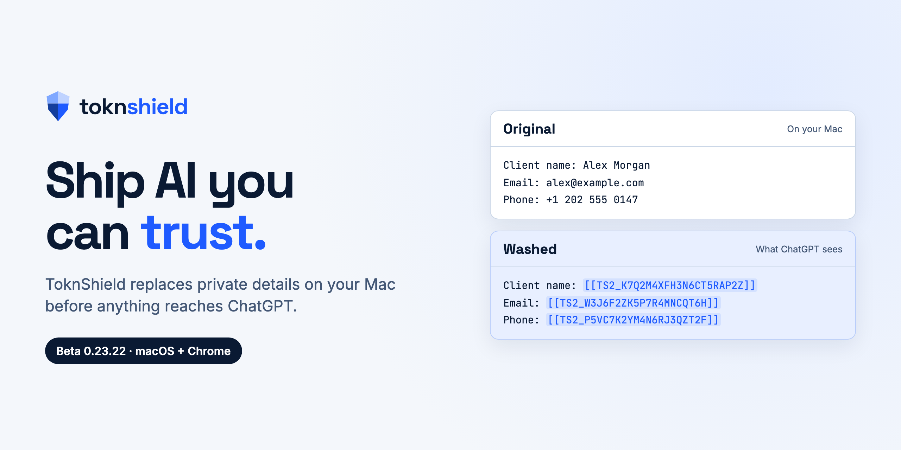
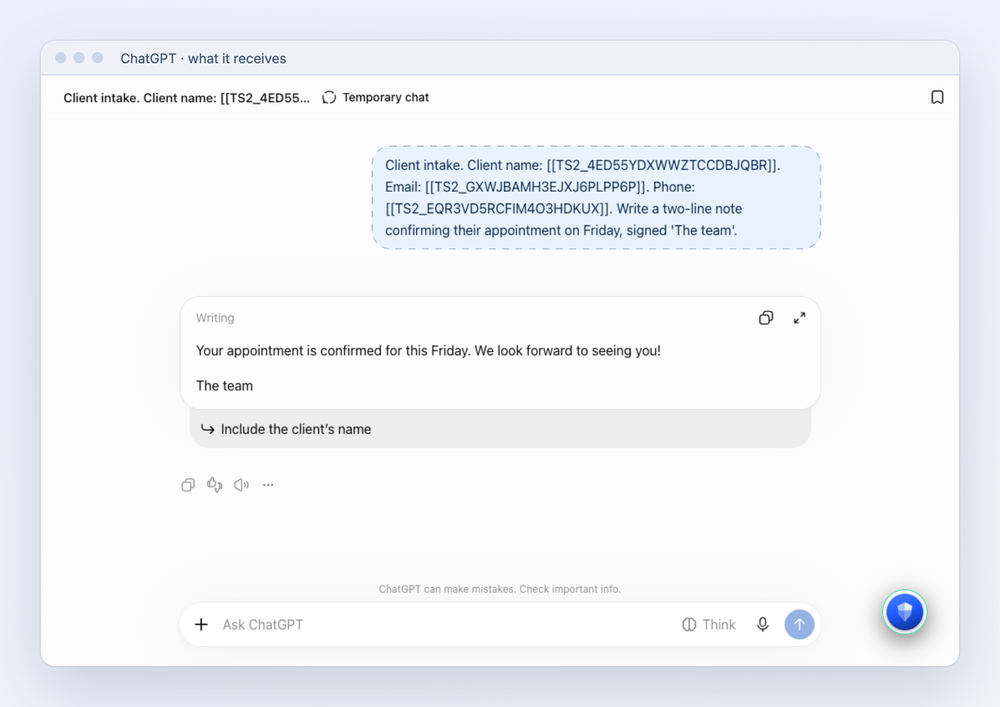
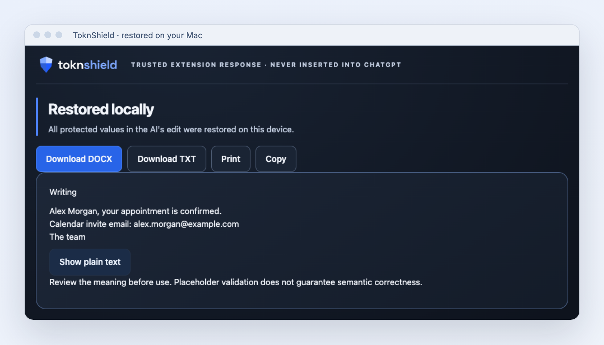
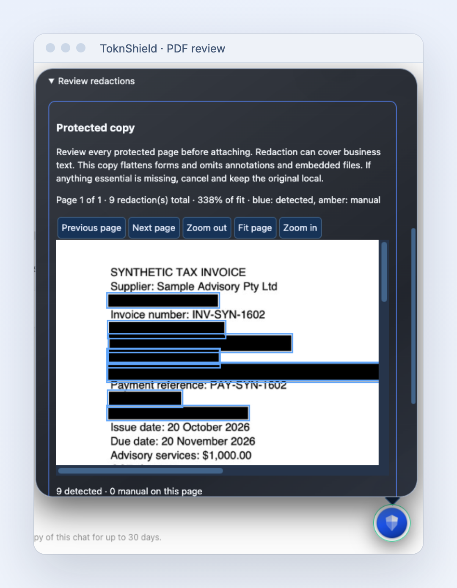

  

  <a href="https://github.com/Tcapinora/ToknShield-beta/releases/tag/v0.23.22-beta"><b>Download the beta</b></a>
  &nbsp;·&nbsp;
  <a href="BETA-INSTALL.md">Install guide</a>
  &nbsp;·&nbsp;
  <a href="mailto:tom@capinora.com">Contact</a>

---

Thanks for joining the ToknShield beta.

ToknShield lets you use ChatGPT without handing over private details. It runs on your Mac. Before a message or document is sent, ToknShield replaces names, email addresses, phone numbers, addresses and account details with safe placeholders. The originals never leave your Mac, and ChatGPT's reply can be restored with the real details, only on your Mac.

## See it in action

<table>
  <tr>
    <td width="50%" valign="top"> <b>ChatGPT only sees placeholders.</b> The client's name, email and phone never reach it.</td>
    <td width="50%" valign="top"> <b>Restored on your Mac.</b> The real details come back in ToknShield's own view, never inside ChatGPT.</td>
  </tr>
  <tr>
    <td valign="top"> <b>Documents too.</b> PDFs and Word files are protected on your Mac. You check every page before anything is attached.</td>
    <td valign="top">

### Your privacy

- **Everything happens on your Mac.** No servers, no accounts, no analytics.
- **ChatGPT only receives the protected version.** It never gets the original text or document you protected.
- **Your originals stay with you.** Nobody else can see them, us included.
- **Only on chatgpt.com.** The extension can't read other websites.
- **When in doubt, it blocks.** If ToknShield can't confirm something is protected, it stops the send. It never falls back to the original.

</td>
  </tr>
</table>

## Get started

1. **[Download the beta](https://github.com/Tcapinora/ToknShield-beta/releases/tag/v0.23.22-beta)**: the Mac app and the Chrome extension.
2. Follow the **[install guide](BETA-INSTALL.md)**. It takes about five minutes.
3. Open ChatGPT in Chrome and send a message. ToknShield takes it from there.

You'll need a Mac with Google Chrome, with ChatGPT set to English. The Mac app is signed by Portfolioapp Pty Ltd and checked by Apple.

## What we'd love you to try

1. Ask ChatGPT about a message that includes a name, email address or phone number.
2. Attach a Word document or a PDF and ask ChatGPT to summarise it.
3. Restore the real details in ChatGPT's reply, in ToknShield's view.
4. Switch protection **Off** and check ChatGPT behaves normally.

Please use made-up or non-sensitive details while you try it out.

## Feedback and help

Email **[tom@capinora.com](mailto:tom@capinora.com)** with anything: bugs, confusing moments, ideas. A screenshot and a sentence about what you were doing helps a lot. Please don't include real personal or client information.

ToknShield is made by Portfolioapp Pty Ltd · <a href="https://toknshield.com">toknshield.com</a>
